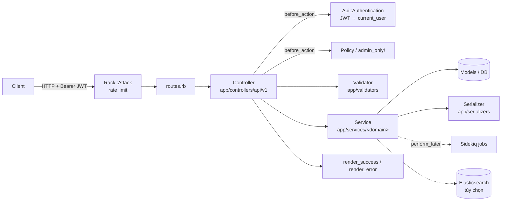

# 01 · Kiến trúc và quy ước code

> Cập nhật theo commit: `3ed8915`

## Tổng quan
- **Store API** là API JSON (Rails 8.1, chế độ `api_only`) cho cửa hàng bán điện thoại.
- Mọi endpoint nằm dưới `/api/v1`, ngoại trừ ba nhóm: `/api-docs` (tài liệu API), `/health` (OkComputer) và `/track/:tracking_number` (tra cứu đơn công khai).
- Kiến trúc là **monolith một DB**. Logic nghiệp vụ nằm trong các service object, chia theo domain trong `app/services/<domain>/`.



## Các tầng

| Tầng | Trách nhiệm | Nên làm | Không nên làm |
|---|---|---|---|
| **Controller** | Nhận params, gọi validator/service, render | Strong params bằng `params.expect(...)` | Viết query hoặc nghiệp vụ |
| **Validator** ([app/validators/](../../app/validators/)) | Kiểm tra input trước khi vào service | Trả về `valid?` và `errors` | Ghi DB |
| **Policy** ([app/policies/](../../app/policies/)) | Ai được làm gì, theo `BasePolicy` (`admin?`, `authenticated?`) | Kiểm tra cả quyền sở hữu (owner) | — |
| **Service** ([app/services/](../../app/services/)) | Nghiệp vụ, transaction, phối hợp nhiều model | Trả Hash `{ success:, ... }` hoặc `{ success: false, errors: [...] }` | Render response |
| **Serializer** ([app/serializers/](../../app/serializers/)) | Model thành Hash JSON (Ruby thuần, `as_json`) | — | Query nặng (cẩn thận N+1: `BrandSerializer` gọi `products.count`) |
| **Model** | Quan hệ, validation, scope, callback nhỏ | — | Gọi sang domain khác qua callback (đang có, xem coupling ở [02](02-domain-map.md)) |

Đọc luồng Brand trước, vì đơn giản nhất:
1. [brands_controller.rb](../../app/controllers/api/v1/brands_controller.rb)
2. [brand_validator.rb](../../app/validators/brand_validator.rb)
3. [brand_service.rb](../../app/services/brands/brand_service.rb)
4. [brand_serializer.rb](../../app/serializers/brand_serializer.rb)
5. [brand_policy.rb](../../app/policies/brand_policy.rb)

## Chuỗi kế thừa controller và concerns

```
ActionController::API
└── ApplicationController        include ErrorHandling; render_success / render_error
    └── Api::BaseController      include Api::Authentication (before_action authenticate_user!)
        │                        include Api::Authorization (authorize!, admin_only!)
        │                        include Common::Pagination, Common::Filtering
        └── Api::V1::BaseController
            └── các controller v1
```

- **Controller mới bắt buộc kế thừa `Api::V1::BaseController`.** Hai controller đang làm sai và hỏng hoàn toàn, xem [KI-002](../known-issues.md#ki-002).
- **Endpoint công khai** dùng `skip_before_action :authenticate_user!`. Ví dụ: `auth_controller`, `orders#track`.
- **[ErrorHandling](../../app/controllers/concerns/error_handling.rb):**
  - `rescue_from` được Rails khớp **từ handler khai báo cuối lên đầu**, nên catch-all `StandardError` phải khai báo trước tiên.
  - `RecordNotFound` → 404, `RecordInvalid` → 422, `ParameterMissing` → 400.
- **[Api::Authorization#authorize!](../../app/controllers/concerns/api/authorization.rb)** không dừng action ([KI-003](../known-issues.md#ki-003)). Hiện tại chỉ gọi nó trong `before_action`.

## Định dạng response (giữ nguyên)

```json
{ "success": true,  "data": { ... }, "message": "Brands retrieved successfully" }
{ "success": false, "message": "Validation failed", "errors": ["Name can't be blank"] }
```

- **Pagination:** nên dùng [`Common::Pagination#pagination_meta`](../../app/controllers/concerns/common/pagination.rb), giới hạn `per_page` tối đa 100. Một số chỗ vẫn tự viết pagination riêng ([KI-018](../known-issues.md#ki-018)).

## Xác thực (JWT)
- **Config** ([config.rb](../../app/services/auth/jwt/config.rb)): HS256, ký bằng `JWT_SECRET_KEY`, nếu không có thì dùng `secret_key_base`.
- **Thời hạn:** access token 30 phút, refresh token 7 ngày. Claim `type` nhận một trong các giá trị `access`, `refresh`, `password_reset`, `email_verification`.
- **Thu hồi token:** dùng hai lớp lưu trữ.
  - Bảng `jwt_blacklist_tokens` là nguồn chính.
  - Redis ([cache_service.rb](../../app/services/auth/jwt/cache_service.rb)) cache theo SHA256 của token, và lưu mốc "logout tất cả" của từng user.
- **Luồng:** `AuthController` → [`Auth::AuthService`](../../app/services/auth/auth_service.rb) → các service con `Jwt::*`. `Api::Authentication` gọi `TokenValidationService.authenticate` cho mỗi request.
- **Vai trò:** `users.role` có hai giá trị, `admin` và `customer`.

## Quy ước bắt buộc
1. **Chạy được trên cả PostgreSQL và MySQL**, vì CI chạy matrix cả hai.
   - Tìm kiếm text dùng [`Search::Like`](../../app/services/search/like.rb), **không viết `ILIKE`**.
   - Cột lưu chuỗi dài (token, URL) dùng `text` hoặc lưu digest, vì `string` trên MySQL chỉ có 255 ký tự ([KI-006](../known-issues.md#ki-006)).
2. **Thay đổi tồn kho phải qua `Product#reduce_stock` / `add_stock` hoặc phương thức tương ứng của variant.** Các method này dùng `with_lock` ([product.rb:88](../../app/models/product.rb)) và ghi `StockMovement`. Có spec kiểm tra đồng thời ở `spec/models/stock_concurrency_spec.rb`.
3. **Style code:** RuboCop, nháy đơn, tối đa 120 ký tự mỗi dòng. Chạy `bin/rubocop -a`.
4. **Git:**
   - Tên nhánh: `feat/…`, `fix/…`, `ci/…`, `chore/…`, `docs/…`.
   - Commit theo Conventional Commits: `feat(search): …`, `fix(stock): …`.
   - Trước khi mở PR, chạy `bin/ci` để kiểm tra giống như CI.

## Thêm một resource mới (checklist)
1. Migration. Kiểm tra lại quy ước 1 ở trên.
2. Model kèm validation, cùng factory trong `spec/factories/`.
3. Policy: thêm chiều owner nếu dữ liệu thuộc về từng user.
4. Validator và service: service trả Hash `success`/`errors`.
5. Serializer.
6. Controller kế thừa `Api::V1::BaseController`, gọi policy bằng `before_action`, rồi thêm vào `routes.rb`.
7. Request spec bằng rswag dùng `ContractSchemas`, mỗi endpoint có ít nhất các case 200, 401, 403 và 422. Cập nhật `swagger/v1/paths/*.yaml` và `components/schemas.yaml`, rồi chạy `bin/rails swagger:merge`.
8. Chạy `bin/ci`.

## Thư mục ít khi phải đụng
- `lib/tasks/`: các task swagger (`swagger:merge`, `swagger:validate`, `swagger:stats`).
- `config/initializers/`: cấu hình Rack::Attack, Sentry, lograge, searchkick, sidekiq, okcomputer, CORS. Xem [04](04-infra-and-ops.md).
