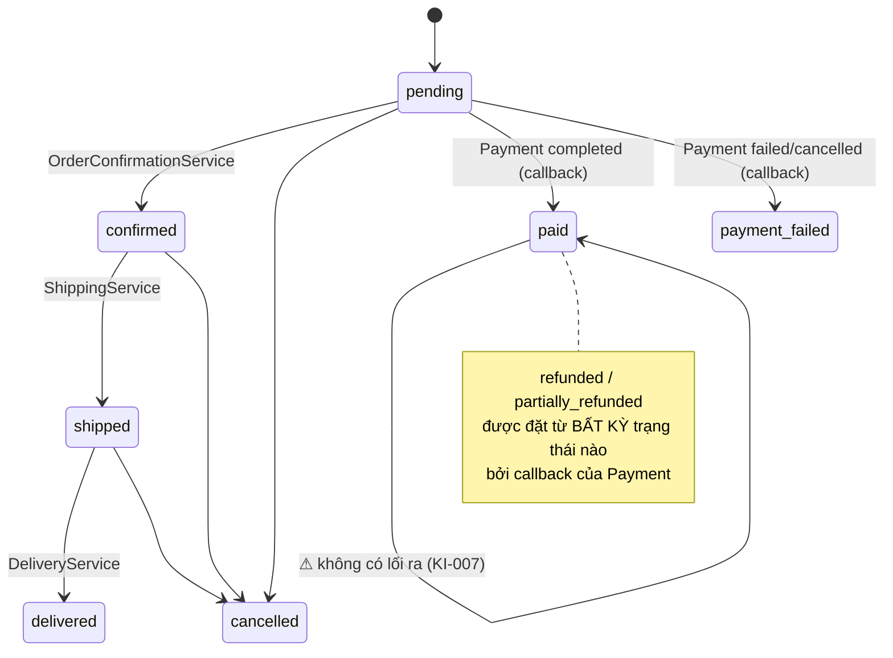
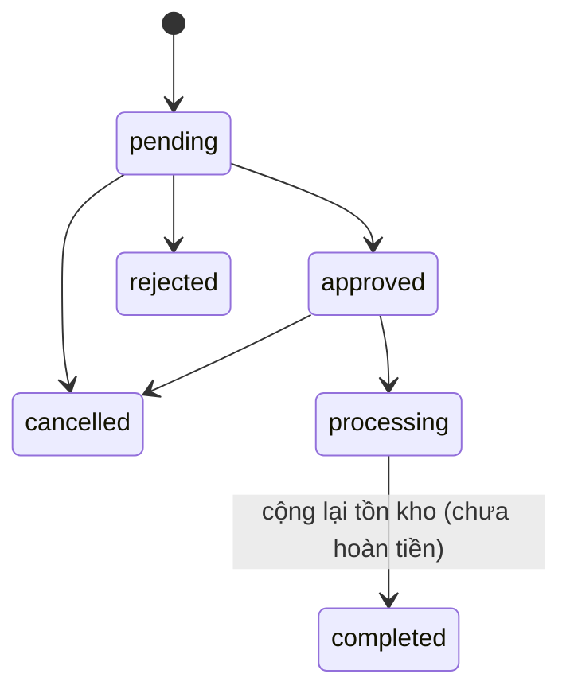
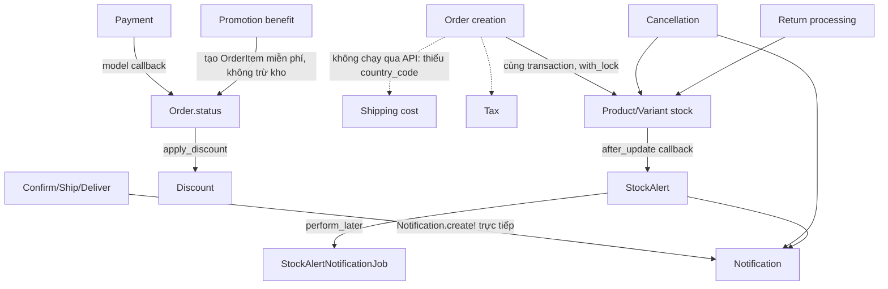

# 02 · Bản đồ domain

> Cập nhật theo commit: `3ed8915`

Tài liệu này dùng khi bạn cần biết một tính năng nằm ở đâu, nó gọi sang domain nào, và nếu tách thành microservice thì đường ranh giới nằm ở đâu.

## Các domain

| Domain | Models chính | Services | Ghi chú |
|---|---|---|---|
| **Auth** | `User`, `JwtBlacklistToken`, `PasswordResetToken` | `auth/auth_service`, `auth/token_validation_service`, `auth/jwt/*` | Xem [01 · Xác thực](01-architecture.md#xác-thực-jwt) |
| **Catalog** | `Product`, `ProductVariant`, `VariantOption`, `Brand`, `Category` | `products/product_service`, `brands/brand_service`, `search/*` | Xóa brand hoặc category sẽ **xóa luôn sản phẩm** (`dependent: :destroy`) |
| **Catalog phụ** | `ProductReview`, `ProductWishlist`, `ProductComparison(+Item)` | Logic nằm trong controller | |
| **Inventory** | `StockMovement`, `StockAlert` | `stock_alerts/*` (9 service) | Thay đổi tồn kho của **product** sinh ra `StockMovement` và alert. Tồn kho của **variant** thì không |
| **Cart** | `Cart` (`active` / `abandoned` / `completed`), `CartItem` | `carts/cart_service` | Không có code nào đặt `completed`. Cart không liên kết với Order |
| **Order** | `Order`, `OrderItem` | `orders/order_{creation,confirmation,cancellation}_service`, `shipping_service`, `delivery_service` | Domain trung tâm |
| **Payment** | `Payment`, `PaymentMethod` | `payments/payment_processing_core_service` (+ facade, webhook, `payment_method_*`) | **Toàn bộ là giả lập** ([KI-011](../known-issues.md#ki-011)) |
| **Pricing** | `Discount`, `Coupon`, `Promotion` | `discounts/*`, `validators/promotion_validator` | Giới hạn lượt dùng không có tác dụng ([KI-010](../known-issues.md#ki-010)) |
| **Fulfilment** | `ShippingZone`, `ShippingMethod`, `ShippingZoneMethod`, `TaxRate` | `shipping/shipping_cost_calculator_service`, `tax/tax_calculator_service` | |
| **Returns** | `ReturnRequest`, `ReturnItem` | `returns/return_processing_service` | Chưa có hoàn tiền ([KI-012](../known-issues.md#ki-012)) |
| **Notification** | `Notification` (21 loại) | Không có module riêng | Mỗi domain tự gọi `Notification.create!` |
| **Users** | `UserAddress` | `users/profile_*`, `users/address_*`, `address/address_validation_service` | |
| **Statistics** | Không có model | Không có service | Query viết trực tiếp trong [statistics_controller.rb](../../app/controllers/api/v1/statistics_controller.rb) |

**Thật hay giả lập**
- **Payment gateway:** giả lập (`SecureRandom`).
- **Email:** chỉ email xác minh tài khoản là gửi thật (`EmailVerificationMailer`). Dev dùng letter_opener, còn SMTP production chưa cấu hình. "Email" thông báo đơn hàng thực ra chỉ ghi log.
- **Job nền:**
  - `JwtCleanupJob` chạy cron lúc 02:00 mỗi ngày ([schedule.yml](../../config/schedule.yml)).
  - `StockAlertNotificationJob` được enqueue khi có alert.

## State machines

### Order
Danh sách trạng thái ở [order.rb:37-47](../../app/models/order.rb). Các bước chuyển được kiểm tra trong từng service bằng `can_be_*?`.

- Admin có thể bỏ qua toàn bộ sơ đồ trên bằng `PATCH status` ([KI-008](../known-issues.md#ki-008)).
- Gốc của vấn đề: `status` đang gộp hai chiều khác nhau, **thanh toán** và **giao hàng**. Hướng sửa nằm ở [roadmap giai đoạn 0](../roadmap/roadmap.md#giai-đoạn-0--sửa-lỗi-nghiêm-trọng).

### Payment
- Các trạng thái: `pending`, `processing`, `completed`, `failed`, `cancelled`, `refunded`, `partially_refunded` ([payment.rb:35](../../app/models/payment.rb)).
- Các helper `mark_as_*!` **không kiểm tra bước chuyển hợp lệ**.
- Callback `update_order_status` ([payment.rb:254](../../app/models/payment.rb)) cập nhật sang Order.

### Return request
Guard nằm trong các method `approve!` / `reject!` / `cancel!` / `complete!` của [return_request.rb](../../app/models/return_request.rb).

## Coupling giữa các domain

Đây là thông tin quan trọng nhất nếu định tách microservice.

| Điểm nối | Kiểu | Vị trí | Mức độ khó khi tách |
|---|---|---|---|
| Order → Stock | Đồng bộ, **cùng transaction DB** | `order_creation_service.rb` (bước trừ kho), `product.rb:88` | **Cao.** Cần saga hoặc cơ chế giữ hàng (reservation) |
| Payment → Order | Callback của ActiveRecord | `payment.rb:254` | Trung bình. Chuyển thành domain event |
| Mọi domain → Notification | Ghi trực tiếp vào bảng | `order_confirmation_service.rb:91`, `shipping_service.rb:75`, `delivery_service.rb:73`, `order_cancellation_service.rb` | **Thấp.** Không nằm trên luồng chính, chỉ cần event một chiều. Là **ứng viên tách đầu tiên** |
| Product → Search index | Async qua Active Job | `product.rb:43`, [reindexes_products_on_rename.rb](../../app/models/concerns/reindexes_products_on_rename.rb) | Thấp. Đã là async và có fallback sang SQL |
| Order → Discount | Đồng bộ | `order.rb:147` | Trung bình |
| Stock → StockAlert | `after_update` callback | `product.rb:76, 165` | Trung bình |

**Lưu ý khi đọc luồng tạo đơn:**
- `order_create_params` chỉ nhận `customer_name`, `customer_email`, `customer_phone` ([orders_controller.rb:201](../../app/controllers/api/v1/orders/orders_controller.rb)). Vì vậy các nhánh tính phí ship và thuế trong `OrderCreationService` **không bao giờ chạy** khi gọi qua API.
- Việc tạo đơn **không** áp discount, **không** tạo payment, **không** gửi notification. Mỗi bước này là một endpoint riêng.
