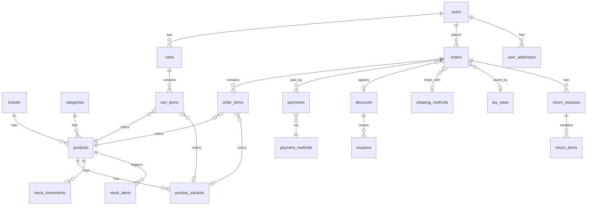

# 03 · Data model

> Cập nhật theo commit: `0b570df` · Nguồn sự thật: [db/schema.rb](../../db/schema.rb)

Tài liệu này chỉ tóm tắt và giải thích lý do. Muốn biết chính xác các cột, đọc `schema.rb`.

## Con số
- **35 bảng**, trong đó 3 bảng là của Active Storage.
- **44 foreign key.** 2 FK dùng `on_delete: :cascade` (`product_comparison_items`), 1 FK dùng `:nullify` (`jwt_blacklist_tokens`).
- **141 index.**

## Nhóm bảng

| Nhóm | Bảng |
|---|---|
| Identity | `users`, `user_addresses`, `password_reset_tokens`, `jwt_blacklist_tokens` |
| Catalog | `brands`, `categories`, `products`, `product_variants`, `variant_options` |
| Engagement | `product_reviews`, `product_wishlists`, `product_comparisons`, `product_comparison_items` |
| Inventory | `stock_movements`, `stock_alerts` |
| Cart | `carts`, `cart_items` |
| Order | `orders`, `order_items` |
| Payment | `payments`, `payment_methods`, `payment_histories` (có bảng nhưng không có model, [KI-017](../known-issues.md#ki-017)) |
| Pricing | `discounts`, `coupons`, `promotions` |
| Fulfilment | `shipping_zones`, `shipping_methods`, `shipping_zone_methods`, `tax_rates` |
| Returns | `return_requests`, `return_items` |
| Khác | `notifications`, `active_storage_*` |

## Lõi giao dịch



## Ràng buộc đáng chú ý
- **Unique:**
  - `users.email`, `product_variants.sku`, `discounts.code`, `coupons.code`, `payments.transaction_id`
  - `(cart_id, product_id)` trên `cart_items`
  - `(user_id, product_id)` trên `product_reviews` và `product_wishlists`
- **Tiền:** dùng `decimal(10,2)`. Không dùng float.
- **Trạng thái:** lưu dạng `string` và dùng `enum` của Rails với giá trị là chuỗi, không dùng enum native của PG. Cách này dễ chuyển sang MySQL.

## Tương thích MySQL / Aurora MySQL
Schema phần lớn đã tương thích:
- Dùng `json` (15 cột), không dùng `jsonb`.
- Không có cột mảng, enum native của PG, check constraint, hay partial index.
- [database.yml](../../config/database.yml) tự đổi adapter sang Trilogy khi `DB_ADAPTER=trilogy`.

Những điểm cần xử lý:

| Rủi ro | Chi tiết | Trạng thái |
|---|---|---|
| `string` thành `VARCHAR(255)` | Token JWT dài 272 ký tự nên insert vào blacklist bị lỗi | **Lỗi thật**, [KI-006](../known-issues.md#ki-006) |
| Cột token khác | `password_reset_tokens.token`, `users.email_verification_token` | Cần đo độ dài token thực tế |
| Collation | MySQL `utf8mb4_0900_ai_ci` không phân biệt hoa/thường và dấu, PG thì có. Unique index và `WHERE` trên chuỗi có thể cho kết quả khác nhau | `User` đã `downcase_email`. Các cột `code` (discount, coupon) cần kiểm tra |
| `enable_extension "plpgsql"` | MySQL bỏ qua dòng này | Vô hại |
| Default scope `order(created_at: :desc)` trên `Order` | Ảnh hưởng mọi query, kể cả `.first` và `.last` | Lưu ý khi viết query |

## Quy ước khi viết migration
1. Thêm FK và index cho mọi cột `*_id`.
2. Chuỗi có thể dài hơn 255 ký tự thì dùng `text`. Nếu cần index, lưu digest.
3. Sau khi migrate, chạy test trên cả hai DB:
   ```bash
   bundle exec rspec
   DB_ADAPTER=trilogy DATABASE_PORT=3307 bundle exec rspec
   ```
4. Commit `db/schema.rb` sinh ra từ PostgreSQL, vì CI chạy `db:schema:load` từ file này.
