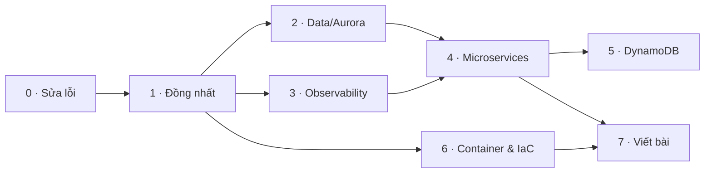

# Roadmap (chạy hoàn toàn ở local)

> Cập nhật theo commit: `3ed8915` · Khoảng trống được phân tích ở [target-stack-gap.md](target-stack-gap.md) · Danh sách lỗi ở [known-issues.md](../known-issues.md)

**Nguyên tắc**
- Làm theo thứ tự giai đoạn. Mỗi giai đoạn gồm nhiều PR nhỏ trên nhánh riêng, PR nào cũng phải pass `bin/ci`.
- Sửa lỗi xong thì cập nhật trạng thái `KI-xxx`, và chỉ nâng ngưỡng coverage, không hạ.
- Giai đoạn 0 và 1 là nền móng. Không nên làm microservice hay K8s khi monolith còn lỗi phân quyền.

**Chi phí cloud của mọi giai đoạn: 0đ.**

---

## Giai đoạn 0 · Sửa lỗi nghiêm trọng
**Mục tiêu:** không còn lỗ hổng phân quyền nào, luồng đặt hàng đến giao hàng chạy được đầu cuối.

| # | Việc | KI | Tiêu chí xong |
|---|---|---|---|
| 0.1 | Bỏ whitelist spec trong `.gitignore` | [KI-020](../known-issues.md#ki-020) | `git check-ignore spec/models/x_spec.rb` không còn kết quả |
| 0.2 | Sửa `authorize!`: dừng action, hỗ trợ truyền class | [KI-003](../known-issues.md#ki-003) | Spec ở concern: action không chạy khi bị 403 |
| 0.3 | Variants và addresses kế thừa đúng base controller | [KI-002](../known-issues.md#ki-002) | Request spec 200/401/403. Spec kiểm tra mọi controller v1 kế thừa `Api::V1::BaseController` |
| 0.4 | Returns: chỉ admin được approve/reject/complete | [KI-001](../known-issues.md#ki-001) | Request spec: customer nhận 403 và DB không đổi |
| 0.5 | Kiểm tra chủ sở hữu ở payments#show và order items | [KI-004](../known-issues.md#ki-004), [KI-005](../known-issues.md#ki-005) | Truy cập tài nguyên của người khác trả 404 |
| 0.6 | Tách `payment_status` khỏi `fulfillment_status` hoặc cho phép `paid → confirmed`; bỏ `status` khỏi params của admin, thay bằng action riêng | [KI-007](../known-issues.md#ki-007), [KI-008](../known-issues.md#ki-008) | Spec luồng pending → paid → confirmed → shipped → delivered |
| 0.7 | Blacklist lưu `token_digest` hoặc `jti` | [KI-006](../known-issues.md#ki-006) | Spec logout pass trên **MySQL** với token thật |
| 0.8 | Sửa `before_send` của Sentry | [KI-009](../known-issues.md#ki-009) | Unit test lambda lọc `password` và `token` |
| 0.9 | Đếm lượt dùng discount một cách atomic, chặn khi vượt giới hạn | [KI-010](../known-issues.md#ki-010) | Spec đồng thời: N thread chạy song song, `used_count` ≤ giới hạn |

**Kỹ năng thể hiện:** phát hiện và sửa lỗi bảo mật, viết test cho tình huống đồng thời, thiết kế state machine.

## Giai đoạn 1 · Đồng nhất và làm sạch
**Mục tiêu:** chỉ còn một cách làm cho mỗi việc, và Swagger là nguồn sự thật được CI kiểm tra.

- **Phân quyền:** chỉ dùng Policy qua `before_action`. Bỏ `ensure_admin!` và các lần gọi `admin_only!` rải rác. Dùng tới `DiscountPolicy`, `PromotionPolicy` và `CategoryPolicy` đang bị bỏ không ([KI-018](../known-issues.md#ki-018)).
- **Pagination:** chỉ dùng `Common::Pagination`, giới hạn 100 bản ghi mỗi trang, mọi endpoint list trả cùng một dạng meta.
- **Code chết:** xóa theo danh sách ở [KI-017](../known-issues.md#ki-017), sửa `make docs` ([KI-019](../known-issues.md#ki-019)).
- **Contract test:** viết rswag cho mọi endpoint. Thêm job CI so sánh route với path trong Swagger và so sánh YAML với JSON ([KI-015](../known-issues.md#ki-015)).
- **Bỏ N+1** trong serializer (ví dụ `products.count` ở Brand). Dùng gem `bullet` khi chạy test.
- **Tiêu chí xong:**
  - Coverage dòng ≥ 60%.
  - Không còn controller nào thiếu request spec.
  - CI fail khi Swagger lệch với route.

**Kỹ năng thể hiện:** thiết kế API nhất quán, tài liệu hóa API, refactor an toàn có test bảo vệ.

## Giai đoạn 2 · Data hướng Aurora MySQL
- **MySQL làm mặc định trong dev** (`DB_ADAPTER=trilogy`), PostgreSQL chỉ còn là lượt thứ hai trong matrix CI.
- **Rà toàn bộ cột `string`** chứa token, URL và mã code. Chuẩn hóa collation cho các cột `code` ([03-data-model](../onboarding/03-data-model.md#tương-thích-mysql--aurora-mysql)).
- **Idempotency key cho `POST /payments` và tạo đơn.** Có bảng `idempotency_keys` và header `Idempotency-Key`.
- **Read replica giả lập:** Rails multiple databases (`reading`/`writing`) chạy trên một MySQL primary và một replica trong compose. Mô phỏng reader endpoint của Aurora.
- **Elasticsearch:** thêm facet (brand, category, khoảng giá), autocomplete, và dashboard so sánh độ trễ giữa ES và SQL.
- **Tiêu chí xong:** CI xanh khi MySQL là mặc định. Có tài liệu "chạy với replica".

## Giai đoạn 3 · Observability (tương đương Datadog/Bugsnag)
- **Log:** giữ lograge, thêm `trace_id`, đẩy về Loki.
- **Metrics:** `yabeda-rails`, `yabeda-sidekiq`, `yabeda-puma` → Prometheus → Grafana. Đo latency theo route, độ dài hàng đợi, tỉ lệ lỗi.
- **Tracing:** `opentelemetry-instrumentation-all` → Jaeger hoặc Tempo.
- **Error tracking:** GlitchTip tự host. Không cần đổi code vì tương thích Sentry SDK.
- **Load test:** k6 cho tìm kiếm sản phẩm và tạo đơn. Đặt SLO, ví dụ p95 < 300 ms.
- Tất cả nằm trong `docker-compose.observability.yml` riêng.
- **Tiêu chí xong:** từ một request lỗi tìm được log, trace và error tương ứng chỉ qua `request_id`. Có bài viết "từ log đến nguyên nhân".

## Giai đoạn 4 · Hướng microservices
**Phải theo đúng thứ tự:** tách module trong monolith trước, sau đó mới tách thành service.

1. **Modular monolith:** dùng `packwerk` để chia package theo domain trong [02-domain-map](../onboarding/02-domain-map.md). Bật kiểm tra dependency trong CI.
2. **Domain event:**
   - Thay callback `Payment → Order` và các lệnh `Notification.create!` gọi trực tiếp bằng event, ví dụ `OrderConfirmed`, `PaymentCompleted`.
   - Ghi event vào bảng `outbox_events` **trong cùng transaction** với dữ liệu nghiệp vụ, rồi dùng relay job để publish.
3. **Tách Notification service** làm service đầu tiên, vì đây là phần ít coupling nhất:
   - Viết bằng Rails API nhỏ, hoặc bằng một ngôn ngữ khác như Go hay Node để thể hiện khả năng làm việc đa ngôn ngữ.
   - Service có DB riêng và nhận event qua RabbitMQ.
4. **Search service:** chỉ đọc, đồng bộ dữ liệu từ event `ProductChanged`.
5. **Order và Inventory:** chỉ viết ADR cho phương án saga hoặc giữ hàng (reservation), chưa triển khai.
- **Tiêu chí xong:**
  - Tắt Notification service thì việc đặt hàng vẫn thành công.
  - Bật lại thì các event còn tồn được xử lý tiếp.

**Kỹ năng thể hiện:** refactor sang microservices, thiết kế kiến trúc, lựa chọn middleware có lập luận ([target-stack-gap](target-stack-gap.md#gợi-ý-chọn-middleware-để-lập-luận-khi-phỏng-vấn)).

## Giai đoạn 5 · DynamoDB
- **Chuyển JWT blacklist sang DynamoDB Local**, dùng `aws-sdk-dynamodb` và trỏ endpoint về local.
  - Partition key là `jti`, dùng TTL attribute để tự xóa bản ghi hết hạn.
  - Bỏ được `JwtCleanupJob`.
- Viết adapter theo interface, để chuyển qua lại giữa backend Redis/DB và DynamoDB bằng biến môi trường.
- **Tiêu chí xong:** chạy được cả hai backend, có benchmark so sánh, CI chạy DynamoDB Local như một service container.

## Giai đoạn 6 · Container và IaC
| Việc | Công cụ | Tiêu chí xong |
|---|---|---|
| Dockerfile production: multi-stage, non-root, có jemalloc, bootsnap precompile | Docker | Image < 300 MB, chạy với `RAILS_ENV=production` |
| Sửa prod compose, thêm worker Sidekiq ([KI-013](../known-issues.md#ki-013)) | Compose | `docker compose -f docker-compose.prod.yml up` thì health check xanh |
| CD: push image lên GHCR khi merge vào main | GitHub Actions | Image được gắn tag theo SHA |
| Helm chart gồm web, worker, migration Job, HPA | kind + Helm | `helm install` trên kind, chạy được rolling update |
| Terraform tạo S3 (Active Storage), DynamoDB, SQS trên LocalStack | Terraform + LocalStack | `terraform apply` idempotent, có module tách riêng |
| Packer build image từ cùng các bước với Dockerfile | Packer (builder docker) | Image chạy giống bản build bằng Docker |
| Ansible provision VM (Docker, user, firewall) và deploy compose | Ansible + Multipass | Chạy playbook lần thứ hai không còn thay đổi nào |

**Ghi chú:** khi đã có cloud, chỉ cần đổi provider và endpoint của Terraform. Code và chart giữ nguyên.

## Giai đoạn 7 · Chia sẻ ra bên ngoài
Mỗi giai đoạn nên kết thúc bằng một bài viết ngắn:
- Giai đoạn 0: *"5 lỗi phân quyền tôi tìm thấy khi đọc một Rails API"*
- Giai đoạn 2: *"Chạy Rails trên cả PostgreSQL và MySQL: VARCHAR(255) và những cái bẫy"*
- Giai đoạn 4: *"Transactional outbox trong Rails, không cần Kafka"*

Có thể tách các phần dùng lại được thành gem OSS nhỏ, ví dụ outbox relay hoặc bộ kiểm tra Swagger lệch với route.
